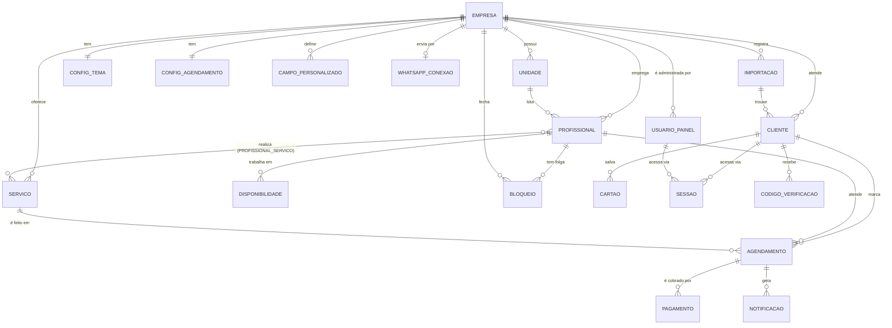

# MODELO DE DADOS

Banco: PostgreSQL. Localmente usa o PGlite (Postgres embutido); em produção, o Supabase. O schema é o mesmo nos dois (`db/schema.sql`).
Convenções: IDs `uuid`, dinheiro em **centavos** (`integer`), horários em `timestamptz`, horários semanais em minutos desde 00:00.

## Diagrama

## Entidades

### empresa
| campo | tipo | nota |
|---|---|---|
| id | uuid PK | |
| nome | text | |
| slug | text UNIQUE | usado na URL pública |
| telefone_whatsapp | text | |
| endereco | text | |
| maps_url | text | link do Google Maps |
| logo_url | text | |
| multiunidade | boolean | |
| pixel_campanha | text null | ID do pixel |
| criado_em | timestamptz | |

### unidade
id, empresa_id FK, nome, endereco, maps_url, ativo.

### usuario_painel (dono / administrador)
id, empresa_id FK, nome, telefone UNIQUE (login do painel, só dígitos), email UNIQUE null, senha_hash, papel (`dono` \| `admin` \| `profissional`), profissional_id FK null, ativo.

### config_tema (1:1 empresa)
empresa_id PK/FK, cor_primaria, cor_secundaria, cor_fundo, cor_texto, modo (`claro` \| `escuro`).

### config_agendamento (1:1 empresa)
| campo | tipo | padrão |
|---|---|---|
| empresa_id | uuid PK/FK | |
| intervalo_slots_min | int | 10 |
| antecedencia_min_min | int | 60 |
| janela_max_dias | int | 30 |
| cancelamento_ate_min | int | 120 (cliente pode cancelar até 2 h antes) |
| remarcacao_ate_min | int | 120 |
| pagamento_modo | text | `desativado` \| `opcional` \| `obrigatorio` |
| pagamento_tipo | text | `minimo` \| `integral` \| `cliente_escolhe` |
| pagamento_minimo_pct | int | 30 |
| pix_expiracao_min | int | 5 |
| fuso_horario | text | `America/Sao_Paulo` |

### campo_personalizado
id, empresa_id, chave (`cpf` \| `cnpj` \| `nascimento` \| `descricao` \| livre), rotulo, tipo (`texto` \| `cpf` \| `cnpj` \| `data` \| `textarea`), obrigatorio, ordem, ativo.

### servico
id, empresa_id, nome, descricao, observacao, preco_centavos, duracao_min, imagem_url, ativo, ordem.

### profissional
id, empresa_id, unidade_id null, nome, foto_url, telefone, comissao_pct, ativo.

### profissional_servico
profissional_id + servico_id (PK composta).

### disponibilidade (expediente semanal)
id, profissional_id, dia_semana (0 = domingo … 6 = sábado), inicio_min, fim_min (ex.: 540 = 09:00). Pode haver várias faixas no mesmo dia; o almoço é a lacuna entre duas faixas.

### bloqueio (folgas e fechamentos)
id, empresa_id, profissional_id null (null = empresa inteira), inicio timestamptz, fim timestamptz, motivo.

### cliente
id, empresa_id, nome, telefone (só dígitos), email null, senha_hash null, telefone_verificado bool, dados_extras jsonb (respostas dos campos personalizados), criado_em. UNIQUE (empresa_id, telefone).

### agendamento
| campo | tipo | nota |
|---|---|---|
| id | uuid PK | |
| empresa_id | FK | |
| cliente_id | FK | |
| profissional_id | FK | |
| servico_id | FK | |
| inicio | timestamptz | |
| fim | timestamptz | inicio + duração |
| preco_centavos | int | congelado no momento do agendamento |
| status | text | `pendente_pagamento` \| `confirmado` \| `concluido` \| `cancelado` \| `faltou` |
| origem | text | `publico` \| `painel` |
| cancelado_por | text null | `cliente` \| `empresa` \| `sistema` |
| expira_em | timestamptz null | prazo do Pix quando o pagamento é obrigatório |
| remarcado_de | uuid null | agendamento original |
| observacao | text | |
| criado_em | timestamptz | |

Restrição anti-conflito: na aplicação, a checagem e a inserção acontecem na mesma transação. No Supabase, a migration acrescenta `EXCLUDE USING gist (profissional_id WITH =, tstzrange(inicio, fim) WITH &&) WHERE status in (...)` com a extensão `btree_gist`, e chaves estrangeiras compostas `(cliente_id|profissional_id|servico_id, empresa_id)` que garantem que tudo seja da mesma empresa.

Colunas acrescentadas: `agendamento.lembrete_enviado_em` (R14b) e `usuario_painel.auth_user_id` (vínculo com o Supabase Auth, usado pela RLS).

### pagamento
id, agendamento_id, metodo (`pix` \| `cartao` \| `local`), tipo (`minimo` \| `integral`), valor_centavos, status (`pendente` \| `pago` \| `expirado` \| `cancelado` \| `estornado`), provedor (`sandbox`), provedor_ref, pix_copia_cola, expira_em, pago_em, criado_em.

### cartao (somente token, nunca o número completo)
id, cliente_id, bandeira, ultimos4, validade_mes, validade_ano, token_provedor, favorito, criado_em.

### sessao
id (token aleatório, guardado como hash), tipo (`cliente` \| `painel`), cliente_id null, usuario_id null, expira_em.

### codigo_verificacao
id, empresa_id, telefone, codigo_hash, expira_em, tentativas, usado.

### notificacao
id, empresa_id, agendamento_id null, canal (`whatsapp` \| `sms` \| `email`), **tipo** (`confirmacao` \| `lembrete` \| `codigo` \| `cancelamento` \| `remarcacao` \| `aviso_empresa` \| `teste`), destino, mensagem, **parametros** jsonb (variáveis do modelo; apagadas após o envio do código), status (`pendente` \| `nao_enviado` \| `aceito` \| `enviado` \| `entregue` \| `lido` \| `falhou`), **provedor_msg_id** (wamid, único), **erro**, criado_em, enviado_em, atualizado_em.

### whatsapp_conexao (v4 · 1:1 empresa)
empresa_id PK/FK, **phone_number_id UNIQUE** (um número só pode servir a uma barbearia), waba_id, numero_exibicao, nome_verificado, **token_cifrado** (AES-256-GCM), app_secret_cifrado null, idioma (`pt_BR`), modelo_confirmacao (+ `_params`), modelo_lembrete (+ `_params`), modelo_codigo (+ `_botao`), lembretes_ativos, status (`conectado` \| `erro`), ultimo_erro, verificado_em, ultimo_webhook_em, criado_em. Sem acesso pela API do Supabase (RLS sem políticas): só o servidor lê.

### importacao (v3)
id, empresa_id, usuario_id, fonte (`arquivo`; futuramente o id do conector de API), formato (`csv` | `xlsx` | `api`), arquivo_nome, status (`rascunho` | `concluida` | `cancelada`), total_linhas, colunas jsonb, **linhas jsonb (só enquanto rascunho)**, mapeamento jsonb, politica_duplicados (`manter` | `completar`), resultado jsonb (contagens + erros por número de linha), criado_em, concluido_em.

### cliente: colunas novas (v3)
`observacoes` (anotações da equipe), `origem` (`agendamento` | `painel` | `importacao`), `importacao_id`.
